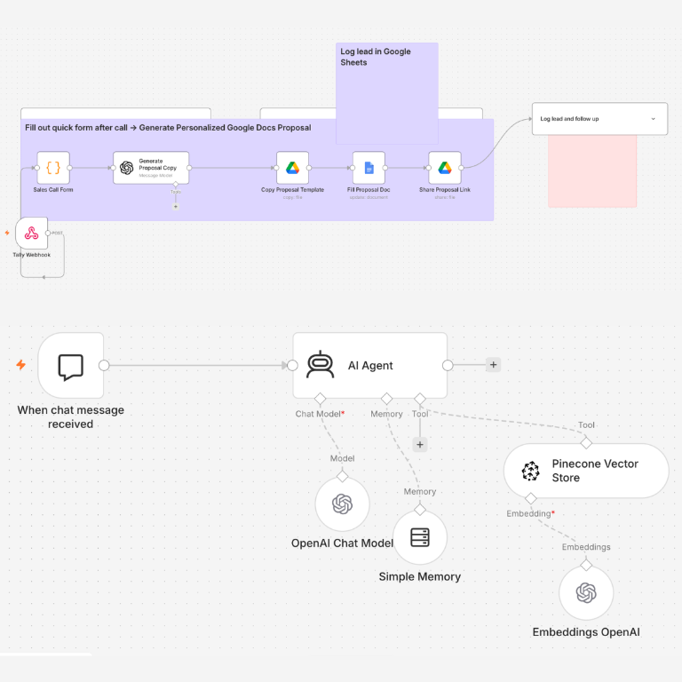

AI delivers the biggest impact when it’s wired directly into your daily workflows—not trapped in a separate chat window. As part of a recent AI bootcamp, I architected two functional n8n solutions designed to eliminate high-friction operational bottlenecks: post-call sales administration and reliable knowledge retrieval.

## 1. Automated Sales Proposal Generator

Submitting a quick post-call Tally form triggers n8n and OpenAI (GPT mini) to draft tailored proposal copy, populate a Google Docs template, log the lead in Google Sheets, and create a ready-to-review Gmail draft. It compresses hours of manual formatting into a two-minute flow while keeping a human in the loop before anything is sent.

## 2. RAG Knowledge Assistant

Combining an n8n AI Agent, OpenAI Embeddings, and a Pinecone vector database, this assistant answers technical questions strictly from verified documentation rather than guessing—and can be adapted to any internal wiki or customer support knowledge base.

## Built for MCP

Both workflows also have Model Context Protocol (MCP) support enabled, allowing them to plug directly into environments like Claude Desktop as ready-to-use tools. Build once, trigger anywhere.

Visual low-code orchestration paired with LLMs makes it faster than ever to turn repetitive routines into reliable, production-ready systems. If your team is looking to streamline sales operations or knowledge management, feel free to reach out—let’s explore what’s possible.
