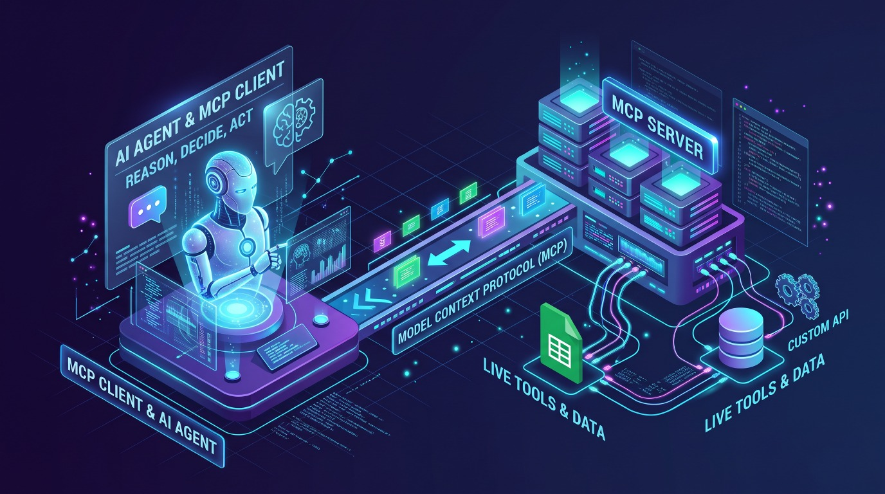

I have been playing around with hands-on MCP workflows lately, and they completely change how AI agents interact with live business tools.

Instead of duct-taping together brittle automations and endless custom API glue, MCP separates the stack into two clean layers:

- **MCP Server:** Hooks into live systems such as spreadsheets, databases, and internal tools, then exposes them through one standard interface.
- **MCP Client and AI Agent:** Discovers the available tools, checks the live state first, and decides what action to take.

## Why this makes scaling AI easier

### Build once, connect anywhere

Set up a toolset once and make it available to any compatible AI agent. The MCP server becomes a reusable capability rather than a one-off integration tied to a particular application or workflow.

### Context replaces rigid rules

Instead of blindly pushing data from one system to another, an agent can inspect live records before acting. That gives the agent enough context to make a safer, more useful decision.

### New tools are easy to add

Need another tool? Hook it up, publish it, and the agent can immediately discover how to use it. Teams do not have to wire every integration into every model or application.

There is already a growing library of ready-to-use MCP servers and registries, so teams can start with common tools instead of building every adapter from scratch.

## Automation is becoming capability

Automation is no longer only about connecting apps. It is about giving AI agents standardized, secure hands to operate real tools and work with live information.

The result is a more flexible architecture: the AI handles context and decisions, while MCP provides a consistent way to discover and use external capabilities.

Are you rolling out MCP in your stack yet? What is the first workflow you would hand over to an agent?