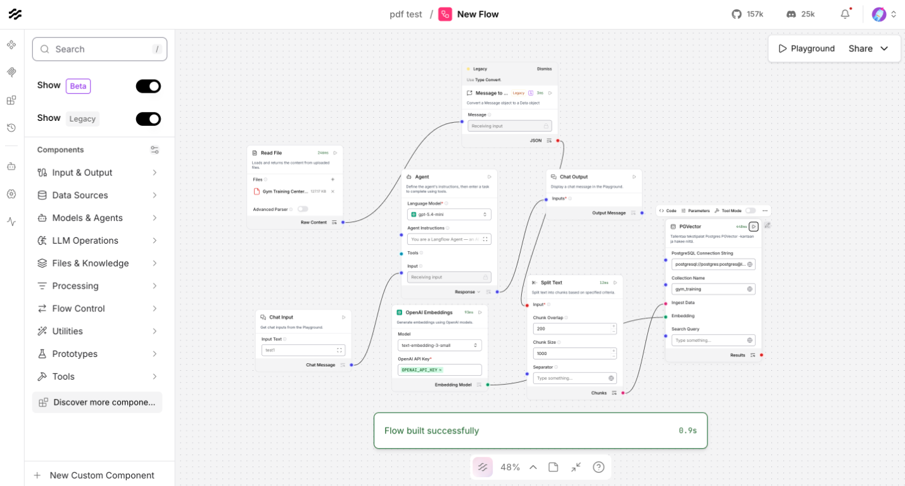

AI delivers the biggest business value when it’s grounded in your own verified data—not adding unnecessary infrastructure complexity. As part of a recent AI bootcamp, I architected an end-to-end RAG pipeline using Langflow and PostgreSQL (pgvector) to solve a common enterprise bottleneck: turning static PDF documentation into a reliable, hallucination-free knowledge tool.

## Decoupled Document Ingestion & Vector Storage

Feeding a PDF guide—tested with a simulated Training Center manual—through Langflow splits the text into structured chunks, generates embeddings via OpenAI (text-embedding-3-small), and stores them directly in PostgreSQL using pgvector. Separating one-time ingestion from live querying and sanitizing JSONB metadata in a custom Python component prevents duplicate vectors while keeping retrieval fast and predictable.

## Tool-Mode AI Agent for Verified Answers

Combining a Langflow AI Agent (gpt-5.4-mini) with the custom PGVector node in Tool Mode, this assistant answers questions strictly from verified documentation rather than guessing—and cleanly separates different knowledge domains into dedicated database collections.

## Built on Existing Infrastructure & Data Control

Keeping relational and vector data side by side in your own PostgreSQL database eliminates new vendor lock-in, simplifies access governance and GDPR compliance, and keeps sensitive source documents inside your own environment. Validate fast, scale safely.

Visual low-code orchestration paired with custom Python and LLMs makes it faster than ever to turn static documentation into production-ready AI systems. If your team is looking to streamline knowledge retrieval or pilot practical AI workflows on your existing stack, feel free to reach out—let’s explore what’s possible.
